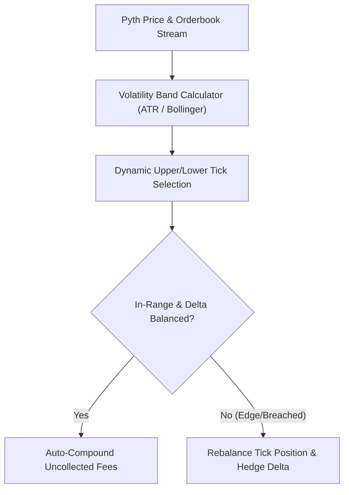

# Agent Morpheus: Active Concentrated Liquidity (CLMM) Range Optimizer

**Morpheus** is an autonomous dynamic quantitative liquidity engine built for Solana Concentrated Liquidity Market Makers (Orca Whirlpools and Raydium CLMM). Operating off-chain, it executes volatility-surface range rebalancing and delta-hedged yield harvesting directly through the single on-chain Cypher Protocol Hub.

---

## Core Operational Mechanism

Traditional passive LPing suffers from out-of-range capital dormancy and severe impermanent loss during trending markets. Morpheus continuously rebalances positions around the high-density trading band using real-time volatility metrics.

### 1. Dynamic Tick Math & Range Expansion
The price $P$ for a given tick index $i$ is calculated as:
$$P(i) = 1.0001^i$$

Morpheus scales the active width $W$ inversely to market volatility $\sigma$:
$$W = W_{\text{base}} \times \text{clamp}\left(\frac{\sigma_{\text{realized}}}{\sigma_{\text{target}}}, 0.5, 3.0\right)$$
- **Low Volatility**: Compresses range width down to capture ultra-high fee multipliers (up to 40x capital efficiency).
- **High Volatility**: Expands range width outward to prevent unprofitable micro-rebalancings.

### 2. Impermanent Loss Delta Hedging
Tracks real-time position delta $\Delta_{\text{pool}}$ and executes offsetting perpetual short/long hedges on Drift/Zeta to maintain net delta-neutral yield farming.

---

## Repository Modules

- [`agent/src/clmm-manager.ts`](agent/src/clmm-manager.ts): Orca & Raydium tick calculations and rebalance trigger logic.
- [`agent/src/volatility-bands.ts`](agent/src/volatility-bands.ts): Hourly realized volatility and dynamic band sizing.
- [`agent/src/il-hedger.ts`](agent/src/il-hedger.ts): Impermanent loss estimation and synthetic delta offsets.
- [`agent/src/trailing-stop.ts`](agent/src/trailing-stop.ts): High-water mark drawdown protection.
- [`audits/reports/03-Report-Agent-Morpheus.pdf`](audits/reports/03-Report-Agent-Morpheus.pdf): 38-page CLMM invariant and tick-safety audit.
