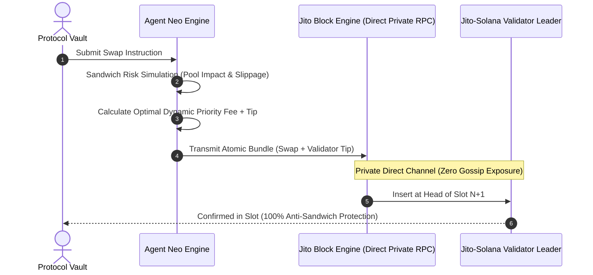

# Agent Neo: Anti-MEV Private Mempool & Jito Bundle Sniper

**Neo** is an autonomous quantitative optimal execution and MEV-protection agent for Solana. Operating off-chain, it breaks large swaps into optimal Almgren-Chriss trajectories and packages them into atomic Jito private bundles, routing directly to validator block engines and through the single on-chain Cypher Protocol Hub to eliminate frontrunning.

---

## Technical Mechanism & Architecture

Public RPC nodes broadcast transactions into the standard validator gossip network, exposing transactions to predatory MEV searchers who execute sandwich attacks (buying before your swap and selling immediately after to extract maximum slippage).

Neo completely bypasses the public gossip mempool by packaging transactions into atomic **Jito Bundles** routed directly to participating validator block engines.

### 1. Atomic All-or-Nothing Guarantee
Jito bundles are executed atomically: if any instruction within the bundle fails (e.g. slippage limit exceeded), the entire bundle reverts. No partial executions or orphaned losses can ever occur.

### 2. Dynamic 75th-Percentile Priority Fee Bidding
Neo analyzes network congestion metrics across the preceding 150 slots to calculate dynamic compute budget fees that guarantee block inclusion without overpaying for priority.

---

## Repository Modules

- [`agent/src/jito-bundler.ts`](agent/src/jito-bundler.ts): Private Jito Block Engine endpoint routing and tipping mechanics.
- [`agent/src/sandwich-simulator.ts`](agent/src/sandwich-simulator.ts): Liquidity impact and predatory attack risk modeling.
- [`agent/src/priority-bidding.ts`](agent/src/priority-bidding.ts): Real-time priority fee percentile sampling.
- [`agent/src/priority-optimizer.ts`](agent/src/priority-optimizer.ts): Compute unit limit clamping and micro-lamport optimization.
- [`audits/reports/05-Report-Agent-Neo.pdf`](audits/reports/05-Report-Agent-Neo.pdf): 19-page anti-MEV and Jito bundle security audit.
