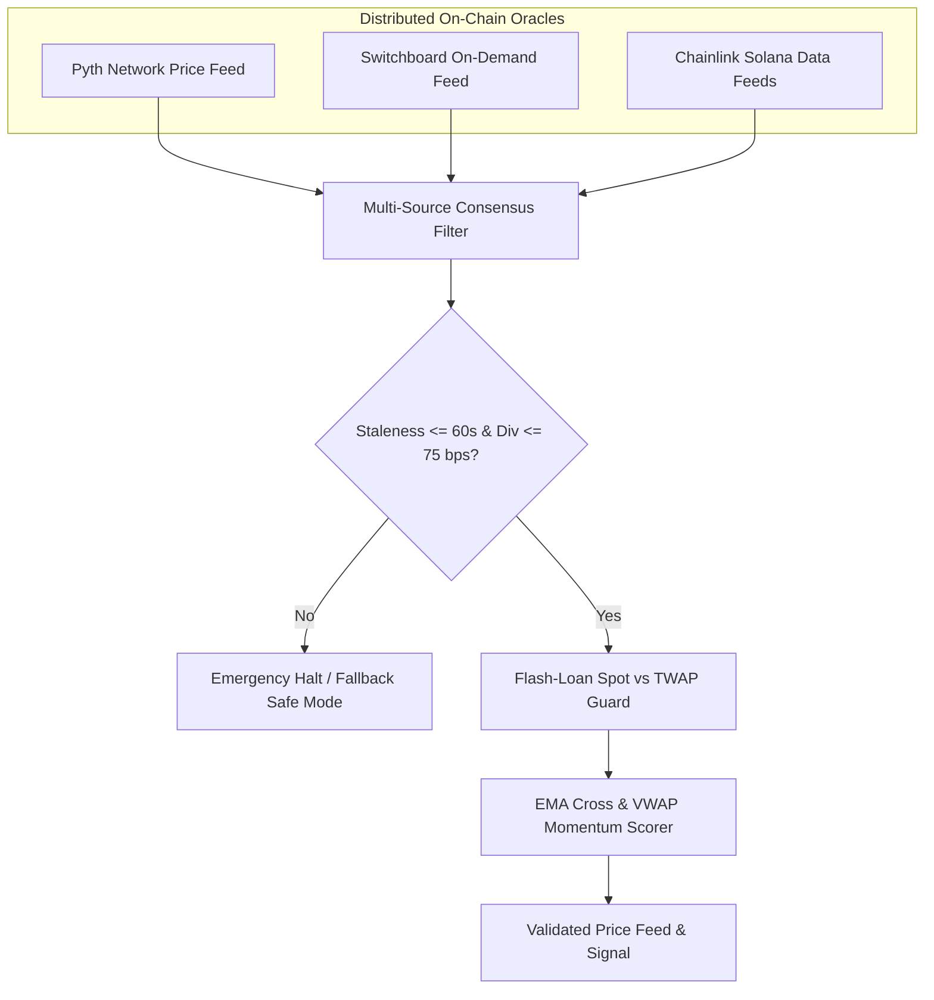

# Agent Oracle: Multi-Source Oracle Aggregator & Anomaly Predictor

**Oracle** is an autonomous market verification and quantitative momentum engine for Solana. Operating off-chain, it continuously synthesizes high-frequency pricing across Pyth Network, Switchboard On-Demand, and Chainlink, executing trend and flow-imbalance strategies through the single on-chain Cypher Protocol Hub while protecting against flash-loan anomalies.

---

## Architecture & Security Philosophy

### 1. Robust Median Consensus Filter
Given reports $P_{\text{Pyth}}$, $P_{\text{Switchboard}}$, $P_{\text{Chainlink}}$:
$$P_{\text{consensus}} = \text{median}\left(\{P_i \mid t_{\text{current}} - t_i \le \Delta t_{\text{max}}\}\right)$$
$$\text{Divergence} = \frac{\max(P_i) - \min(P_i)}{P_{\text{consensus}}} \times 10000 \text{ bps}$$
If $\text{Divergence} > 75\text{ bps}$, transactions are blocked to guarantee absolute solvency.

### 2. Spot vs TWAP Flash-Loan Anomaly Detection
Detects momentary multi-million dollar liquidity drain attacks. If spot price diverges from the 30-minute Time-Weighted Average Price by $>150\text{ bps}$, execution is aborted.

---

## Repository Modules

- [`agent/src/oracle-consensus.ts`](agent/src/oracle-consensus.ts): Cross-oracle median calculation and divergence limits.
- [`agent/src/flashloan-detector.ts`](agent/src/flashloan-detector.ts): Instant spot-vs-TWAP manipulation filter.
- [`agent/src/momentum-predictor.ts`](agent/src/momentum-predictor.ts): Dual EMA cross (12/26) and VWAP trend scorer.
- [`agent/src/oracle-guard.ts`](agent/src/oracle-guard.ts): Pyth spot vs EMA circuit breaker.
- [`audits/reports/04-Report-Agent-Oracle.pdf`](audits/reports/04-Report-Agent-Oracle.pdf): 24-page multi-oracle consensus evaluation.
