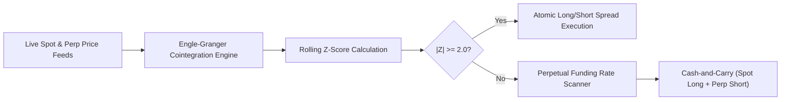

# Agent Quantum: Statistical Cointegration & Delta-Neutral Basis Engine

**Quantum** is an autonomous quantitative statistical arbitrage and basis-trading engine for Solana. Operating off-chain, it monitors cointegrated pairs (SOL/mSOL, JTO/SOL, BONK/WIF) and perpetual funding rates across Drift and Zeta, executing delta-neutral cash-and-carry and mean-reversion trades through the single on-chain Cypher Protocol Hub.

---

## Quantitative Trading Mechanisms

### 1. Engle-Granger Cointegration & Z-Score Mean Reversion
Two asset price series $Y_t$ and $X_t$ are cointegrated if there exists a hedge ratio $\beta$ such that the residual spread $\epsilon_t = Y_t - \beta X_t$ is stationary $I(0)$.
The normalized spread Z-score is computed over a rolling 48-hour window:
$$Z_t = \frac{\epsilon_t - \mu_\epsilon}{\sigma_\epsilon}$$
- **$Z_t \le -2.0$**: Spread is abnormally compressed. Enter **Long Spread** (Buy $Y$, Sell $\beta X$).
- **$Z_t \ge +2.0$**: Spread is abnormally blown out. Enter **Short Spread** (Sell $Y$, Buy $\beta X$).
- **$|Z_t| \le 0.25$**: Exit and take profit on mean-reversion.

### 2. Delta-Neutral Cash-and-Carry Basis Harvesting
When perpetual funding rates on Drift or Zeta are positive (longs paying shorts), Quantum buys spot tokens and opens an equivalent synthetic short perpetual position. This locks in 15%–45% annualized APY with zero directional price risk.

---

## Repository Modules

- [`agent/src/cointegration.ts`](agent/src/cointegration.ts): Engle-Granger linear regression and rolling Z-score calculator.
- [`agent/src/basis-harvester.ts`](agent/src/basis-harvester.ts): Perpetual funding rate harvester and cash-and-carry evaluator.
- [`agent/src/zscore-execution.ts`](agent/src/zscore-execution.ts): Mean-reversion state machine with trailing bounds.
- [`agent/src/adaptive-slippage.ts`](agent/src/adaptive-slippage.ts): Depth-scaled route slippage optimization.
- [`audits/reports/06-Report-Agent-Quantum.pdf`](audits/reports/06-Report-Agent-Quantum.pdf): 35-page quantitative modeling and backtest verification audit.
