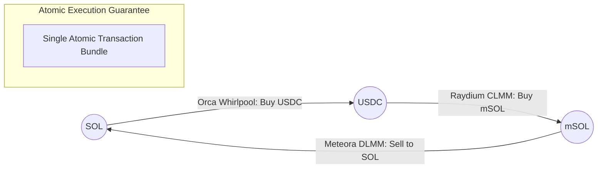

# Agent Trinity: Cross-DEX Triangular & Cyclic Spatial Arbitrage Engine

[](LICENSE)
[](../README.md)
[](audits/reports/02-Report-Agent-Trinity.pdf)

**Trinity** is an autonomous high-frequency quantitative arbitrage engine for Solana. It operates as an off-chain daemon that discovers zero-inventory-risk spatial and triangular cycles across decentralized exchanges (Orca Whirlpools, Raydium CPMM/CLMM, Meteora DLMM, and Phoenix orderbook) and routes execution atomically through the single on-chain Cypher Protocol Hub.

---

## Core Algorithmic Architecture

Trinity models the Solana decentralized exchange ecosystem as a directed, weighted exchange-rate graph $G = (V, E)$, where vertices $V$ represent SPL tokens and directed edges $E$ represent liquidity pools.



### 1. Negative-Cycle Detection (Bellman-Ford Log Transform)
For an ordered sequence of swaps $T_1 \to T_2 \to \dots \to T_k \to T_1$ with exchange rates $R_i$ and liquidity fees $f_i$:
$$\text{Gross Return} = \prod_{i=1}^k R_i (1 - f_i)$$

Taking the negative natural logarithm converts the multiplication into a shortest-path summation:
$$w_i = -\ln(R_i (1 - f_i))$$
$$\sum_{i=1}^k w_i < 0 \iff \prod_{i=1}^k R_i (1 - f_i) > 1.0$$

Trinity continuously executes an optimized Bellman-Ford relaxation loop over live WebSocket orderbook updates to detect negative cycles within sub-10ms latency.

### 2. Net Alpha & Execution Feasibility
An arbitrage cycle is only submitted to the network when net alpha exceeds the total cost barrier:
$$\text{Net Profit} = \left( V_{\text{out}} - V_{\text{in}} \right) - \left( C_{\text{compute}} + C_{\text{priority\_fee}} + C_{\text{tip}} \right) > \text{Threshold}$$

---

## Repository Structure & Modules

- [`agent/src/graph-arbitrage.ts`](agent/src/graph-arbitrage.ts): Directed graph construction and Bellman-Ford cycle solver.
- [`agent/src/spatial-arb.ts`](agent/src/spatial-arb.ts): Direct two-pool spread evaluator with fee & liquidity depth filtering.
- [`agent/src/volatility.ts`](agent/src/volatility.ts): Confidence-adjusted execution sizing.
- [`audits/reports/02-Report-Agent-Trinity.pdf`](audits/reports/02-Report-Agent-Trinity.pdf): Formal 27-page algorithmic verification and backtesting report.

---

## Quickstart

```bash
cd agent-trinity
npm install
npm run typecheck
npm run test:unit
```
